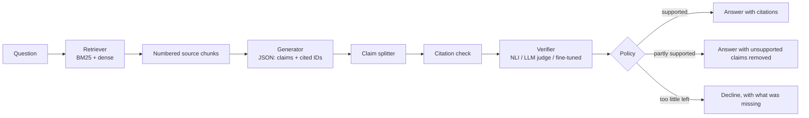

# groundguard

A claim-level grounding guard for retrieval-augmented generation. It sits
between the retriever and the user: every claim in a generated answer is
checked against the sources it cites, unsupported claims are dropped, and the
system declines to answer when too little survives.

> Status: early development. Nothing below the scaffold is implemented yet;
> sections describe the intended design and are updated as pieces land.

## Problem

RAG assistants are usually evaluated on whether the answer looks right, not on
whether each statement in it is actually backed by the retrieved text. A model
that sees the right documents can still add details that aren't in them, or
cite a chunk that says something else. Answer-level checks hide this: one
fabricated sentence inside an otherwise correct answer passes.

The opposite failure matters too. A guard that refuses whenever it is unsure
looks safe on a hallucination metric and is useless in practice, so
over-refusal is measured alongside hallucination rate.

## Approach



1. The model sees only numbered source chunks and must return schema-validated
   JSON where every claim lists the chunk IDs it relies on.
2. The guard checks that cited IDs exist, then asks a verifier whether each
   claim is entailed by its cited chunks.
3. A configurable policy rejects the answer, drops unsupported claims, or
   declines below a support threshold.
4. An eval harness reports hallucination and over-refusal rates, verifier
   precision/recall, latency and cost, with bootstrap confidence intervals.

## Results

Seeded sample of 300 RAGTruth test responses; 95% bootstrap intervals over
responses. Full methodology and limitations are in
[docs/results.md](docs/results.md), and the run output is committed under
[results/ragtruth/](results/ragtruth/).

| System | Hallucinated claims | Over-refusal | Added latency (p50) | Added cost / answer |
|---|---|---|---|---|
| Plain RAG (no guard) | 8.3% [6.0, 11.0] | 0.0% | — | — |
| Guard + NLI verifier | 2.3% [1.5, 3.2] | 15.7% [11.7, 19.7] | 4.46 s (CPU) | $0 (local) |
| Guard + LLM judge | TBD | TBD | TBD | TBD |
| LLM self-check | TBD | TBD | TBD | TBD |

The LLM-based rows are configured but not yet run.

## Quickstart

Requires Python 3.11 and [uv](https://docs.astral.sh/uv/).

```bash
git clone https://github.com/Alfoko/groundedGuard.git
cd groundedGuard
uv sync
uv run pytest
```

Ingesting the demo corpus and the `groundguard ask` CLI are not implemented yet.

## Data

- Demo corpus: the [Kubernetes documentation](https://github.com/kubernetes/website),
  licensed CC BY 4.0. It is downloaded at a pinned version by an ingest script
  and is not committed to this repository.
- Benchmark: RAGTruth, using its official train/test split. Training uses train
  only, tuning uses a held-out dev slice of train, and results are reported on
  test.

## Licence

MIT. See [LICENSE](LICENSE).
