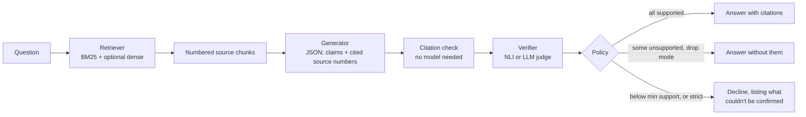

# groundguard

A claim-level grounding guard for retrieval-augmented generation. It sits
between the generator and the user: every claim in an answer is checked
against the sources it cites, unsupported claims are dropped, and the system
declines, saying what it couldn't confirm, when too little survives.

## Headline

On 300 RAGTruth test responses, every guard configuration cut the share of
shown claims that annotators marked as hallucinated from **8.3%** to
between 1.4% and 5.0%. The best trade-off was the guard with an LLM judge
(`gpt-4o-mini`): **2.6%** hallucinated claims, statistically
indistinguishable from the local NLI verifier's 2.3%, while declining
**9.7%** of answerable questions against NLI's 15.7% (paired p = 0.007), for
about a tenth of a cent per answer. All the verifiers flag many correct
claims too (precision 18–28%), so most of what a guard drops was fine.

## Problem

RAG assistants are usually judged on whether the answer looks right, not on
whether each statement in it is backed by the retrieved text. A model that
sees the right documents can still add details that aren't in them, or cite
a chunk that says something else. Answer-level checks hide this: one
fabricated sentence inside an otherwise correct answer passes.

The opposite failure matters too. A guard that refuses whenever it is unsure
looks safe on a hallucination metric and is useless in practice, so
over-refusal is measured alongside hallucination rate.

## Approach



1. The model sees only numbered source chunks and must return
   schema-validated JSON in which every claim lists the sources it relies on.
2. Claims that cite nothing, or only sources the model was never shown, fail
   before any verifier runs.
3. A verifier judges each remaining claim against its cited chunks: a local
   NLI cross-encoder, or an LLM judge that sees all cited passages at once.
4. The policy keeps or drops claims, or declines below a support threshold.
5. The eval harness measures hallucination and over-refusal rates, verifier
   precision and recall, latency and cost, with bootstrap intervals and
   paired permutation tests.

More detail in [docs/design.md](docs/design.md).

## Results

Seeded sample of 300 RAGTruth test responses (seed 13); brackets are 95%
bootstrap intervals over responses. Methodology and limitations are in
[docs/results.md](docs/results.md); the run output, including per-response
records, is committed under [results/ragtruth/](results/ragtruth/).

| System | Hallucinated claims | Answers with a hallucination | Over-refusal | Latency p50 | Cost / answer |
|---|---|---|---|---|---|
| No guard | 8.3% [6.0, 11.0] | 32.0% [26.7, 37.3] | 0.0% | — | — |
| Guard + NLI verifier | 2.3% [1.5, 3.2] | 11.1% [7.3, 15.1] | 15.7% [11.7, 19.7] | 4.46 s (CPU) | $0 (local) |
| Guard + LLM judge | 2.6% [1.7, 3.4] | 13.3% [9.4, 17.4] | 9.7% [6.3, 13.0] | 8.35 s | $0.0011 |
| Guard + LLM judge, strict | 1.4% [0.7, 2.2] | 8.2% [4.1, 12.9] | 51.3% [45.7, 57.0] | — | $0.0011 |
| LLM self-check (one call) | 5.0% [2.3, 8.3] | 10.5% [7.1, 14.2] | 5.0% [2.7, 7.7] | 0.72 s | $0.00014 |

Every guarded row differs from no guard on all three rates with paired
permutation p < 0.001. The LLM rows use `openai/gpt-4o-mini`; the strict
row reused the judge's cached verdicts, so it has no meaningful latency of
its own. Strict mode declines half of all answers, so `drop` is the default
policy.

## Quickstart

Requires Python 3.11 and [uv](https://docs.astral.sh/uv/).

```bash
git clone https://github.com/Alfoko/groundedGuard.git
cd groundedGuard
uv sync
uv run pytest
```

The core install is small. Heavier pieces are optional extras: `nli`
(transformers + torch, for the local verifier), `service` (FastAPI),
`demo` (Gradio) and `embeddings` (sentence-transformers, for dense
retrieval).

### Check an answer you already have

The guard doesn't need this project's retriever or generator. Run the
service in verify-only mode and send it an answer plus the sources it was
based on:

```bash
uv sync --extra nli --extra service
uv run groundguard serve
```

```bash
curl -s localhost:8000/verify -H 'content-type: application/json' -d '{
  "sources": [{"text": "The backoffLimit field sets the number of retries before a Job is considered failed. The default is 6."}],
  "answer": "A Job is marked failed after 6 retries by default. Failed Jobs are deleted after an hour."
}'
```

The response lists every sentence with its verdict, score and whether it
was kept, plus the message the user would see. `"policy": {"mode": "strict"}`
or `"min_support": 0.8` change the policy per request. `/verify` also accepts
pre-split `claims` with their own citations.

### Ask questions over the Kubernetes docs

```bash
uv run groundguard ingest            # fetches kubernetes/website at a pinned commit
export LLM_BASE_URL=https://api.openai.com/v1 LLM_MODEL=gpt-4o-mini LLM_API_KEY=...
uv run groundguard ask "How many times does a Job retry a failed Pod?" --guard nli
```

Any OpenAI-compatible endpoint works. Without `--guard` the raw generated
answer is printed, which is handy for comparing.

### Demo

```bash
uv sync --extra nli --extra demo
uv run groundguard demo              # http://127.0.0.1:7860
```

One tab checks pasted text against pasted sources; the other runs the full
pipeline when an index and an LLM endpoint are configured. Both have a
guard on/off toggle and show each claim's citations, verdict and score.

### Docker

```bash
docker build -t groundguard .
docker run -p 8000:8000 groundguard
```

A CPU-only image with the NLI weights baked in; mount `data/index` and pass
the `LLM_*` variables to enable `/ask` as well. See the comments at the top
of the [Dockerfile](Dockerfile).

### Reproduce the results

```bash
git clone https://github.com/ParticleMedia/RAGTruth data/raw/RAGTruth
git -C data/raw/RAGTruth checkout c103204b9ce28d6bbad859304bf30de72b8ed8fe
uv sync --extra nli
uv run groundguard eval configs/ragtruth/baseline.yaml
uv run groundguard eval configs/ragtruth/nli.yaml       # slow on CPU; resumable
uv run groundguard compare
```

The LLM configs (`judge.yaml`, `judge-strict.yaml`, `self_check.yaml`) also
need the `LLM_*` variables; `budget_usd` in each config caps what a run may
spend, and calls are cached in `.cache/` so a rerun costs nothing. Every run
saves progress per response and resumes if interrupted.

## How this compares

- **[Guardrails AI](https://github.com/guardrails-ai/guardrails)** is a
  general framework for wrapping LLM calls in validators (format, content,
  and community-contributed checks). groundguard does one of those jobs, checking
  grounding against retrieved sources, claim by claim, and comes with a way to
  measure what that check costs in over-refusal.
- **[NeMo Guardrails](https://github.com/NVIDIA/NeMo-Guardrails)** controls
  whole conversations with programmable input, dialogue and output rails;
  its output rails include fact-checking against retrieved evidence.
  groundguard is much narrower: a library and a small HTTP service, with no
  dialogue layer.
- **[RAGAS](https://github.com/explodinggradients/ragas)** is an evaluation
  library with metrics such as faithfulness and context precision, used
  offline to score a RAG system. groundguard acts at answer time, deciding
  what the user sees, and its eval harness scores that decision against
  human hallucination labels rather than against another model's judgement.

## Limitations

- One LLM (`gpt-4o-mini`) for the judge and self-check rows.
- The NLI threshold and support threshold are defaults, not tuned on the
  held-out dev slice; the low precision above is partly a consequence.
- The NLI verifier scores each cited chunk separately, so claims that need
  two passages together come out as not supported.
- RAGTruth responses carry no citations, so in the eval every claim cites the
  whole context. Labels are sentence-level, which is coarser than the
  annotation.
- English only, one benchmark, CPU latency only.

## Future work

- Tune the NLI threshold and `min_support` on the dev slice, and try
  stronger judge models.
- A verifier fine-tuned on RAGTruth train (and the training pipeline for it),
  which was in the original plan and cut for time.
- A RAGAS faithfulness baseline in the same harness.
- Experiment tracking (MLflow) and a minimum detectable effect calculation
  to size eval samples.
- An eval regression gate on pull requests.
- docker-compose for service + index, and packaging the verifier for the
  Hugging Face Hub.

## Repository layout

```
src/groundguard/   library: chunking, retrieval, generation, citations,
                   verifiers, guard, eval, stats, service, demo, CLI
configs/ragtruth/  one YAML config per evaluated system
results/ragtruth/  committed eval output and the comparison table
docs/              design notes and the results write-up
tests/             unit, golden-file and API tests (no network)
```

## Data

- Demo corpus: the [Kubernetes documentation](https://github.com/kubernetes/website),
  CC BY 4.0, fetched at a pinned commit by `groundguard ingest` and never
  committed.
- Benchmark: [RAGTruth](https://github.com/ParticleMedia/RAGTruth), official
  train/test split. A dev slice of train is held out by source context for
  tuning; results are reported on test.

## Licence

MIT. See [LICENSE](LICENSE).
